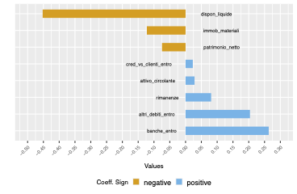
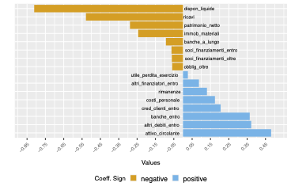

# Credit Risk Prediction With Statistical Learning
## Comparing New Methods Using Italian Financial Reports

Master's Thesis in Finance and Risk Management (University of Parma).

Thesis supervisor: Prof. Fabrizio Laurini.

## Purpose
This project compares four classification methods for estimating the 
Probability of Default (PD) of Italian companies:

- Logistic Regression with Lasso (L1) penalty
- Linear Discriminant Analysis (LDA)
- Quadratic Discriminant Analysis (QDA)
- Classification Trees

These models are estimated on three cross-sections, 2016, 2020 (COVID-19 pandemic)
and 2023 (post-pandemic and inflation surge), to compare their behaviour under
different economic conditions.

The inputs are raw balance-sheet and income statement items rather than 
financial ratios: the latter are just ratios of random variables that could
result in new random variables, which could violate model assumptions and 
complicate data transformations.

## Data
Source: AIDA (Bureau van Dijk), accessed through the University of Parma
licence. **The data are not included in this repo** due to licence restrictions.

Sample selection:

- limited companies (listed and unlisted); partnerships, cooperatives and 
consortia excluded.
- companies located in Northern Italy
- agriculture, banks, insurance companies and public administration excluded
- legal status: active (solvent), active (insolvent), bankrupt, ceased (bankruptcy);
companies in liquidation excluded since liquidation is a voluntary procedure.
- abridged financial statements used as common reference to pick variables;
values in thousands of euros.

|Year | Companies| Defaults| Default rate|
|:----|---------:|--------:|------------:|
|2016 |    89,235|    2,423|       0.0272|
|2020 |   104,680|      704|       0.0067|
|2023 |   126,111|      130|       0.0010|

**Default encoding:** 1 if AIDA legal status is active (insolvent), bankrupt,
or ceased (bankruptcy); 0 if active (solvent). Legal status as reported by AIDA 
at download, May 2026.

**Predictors:** 16 balance-sheet and income-statement items selected with 
`caret::findCorrelation` (cutoff = 0.8, estimated on 2016 data and applied to 
all years), plus sector dummies built from 2-digit NACE Rev.2 codes.

## Repository structure
| File | Content |
|--- | ---|
| `01-data-wrangling.R` | Import and cleaning of AIDA data, variable selection, default and sector dummies |
| `02-pre-eda.R`| Exploratory data analysis |
| `03-data-transformation.R` |  Variable transformations (jittering, Yeo-Johnson, Box-Cox) |
| `04-applied-stat-learning.R` | Model estimation and evaluation |
| `minkowski-dist.R` | Illustration of L1 vs L2 constraint regions (Lasso vs Ridge) |

Scripts are meant to be run in numerical order. **They expect `data/` and `rdas/`
folders, which are not provided**.

## Requirements
R 4.6.2. Packages: data.table, tidyverse, readxl, janitor, lubridate, caret,
kableExtra, ggthemes, tidytext, patchwork, e1071, bestNormalize, glmnet, MASS, 
rpart, pROC, ggforce, latex2exp.

## Methodology
**Exploratory data analysis** (`02-pre-eda.R`): distribution of companies and 
defaults by sector and legal form; histograms, boxplots and Q-Q plots of 
financial statement items (raw and log10 scale); kurtosis of each variable by year.

**Transformations** (`03-data-transformation.R`): zero values are jittered with 
random numbers drawn from $U(0, 1)$; Yeo-Johnson is applied to columns with at least
one negative value; Box-Cox to strictly positive columns.

**Models** (`04-applied-stat-learning.R`):
- *Lasso logistic regression*: $\lambda$ selected by 10-fold cross-validation, 
using `lambda.1se`; predictors include sector dummies.
- *LDA and QDA*: financial statement variables only.
- *Classification Trees*: complexity hyperparameter selected by 10-fold 
cross-validation, followed by pruning.

**Performance assessment:** ROC curves and AUC; confusion matrices, sensitivity, 
specificity and hit rate.

**2023 special case:** three sectors (real estate, energy, mining) have no 
defaults, which causes quasi-complete separation and convergence problems in the 
logistic model. The problem was diagnosed by fitting an unpenalized logistic 
regression (`glm`). These sectors and the corresponding companies are removed,
and the Lasso is re-estimated on an undersampled dataset (all defaulted 
companies + 5% random sample of solvent companies).

## Results
Area Under the Curve (AUC) by model and year:

|Model               |   2016|   2020|   2023  |
|:-------------------|------:|------:|--------:|
|Logistic Lasso      | 0.7274| 0.7466| 0.8248\*|
|LDA                 | 0.7203| 0.7696| 0.8722  |
|QDA                 | 0.7399| 0.7933| 0.8982  |
|Classification tree | 0.5620| 0.5000| 0.7445  |

\* *Undersampled dataset without the three zero-default sectors; not directly
comparable with other models.*

- QDA achieves the highest AUC in all three years; LDA and Lasso perform similarly.
- Classification trees perform poorly because of the strong class imbalance. In 
2020 the cross-validation selects a tree with the root only, which assigns the 
same probability to all companies (AUC = 0.5). The 2023 value is unreliable and 
probably reflects the random assignment of observations to the cross-validation folds.
- All AUC values are in-sample. See Limitations.

Unlike LDA, the Lasso performs feature selection: in 2016 it keeps 8 out of the 
16 financial variables and sets the others to zero. LDA keeps all variables, but 
allots small weights to most of those excluded by the Lasso. Both methods agree
on the most informative ones: cash and equity reduce default risk, short-term bank
debt and other short-term liabilities increase it.

 

*Lasso (left) and LDA (right) coefficients (2016). Only financial reports variables
are shown; the Lasso also keeps some sector dummies (i.e. transports, textile 
and hospitality increase default risk, professional services and communication 
reduce it). Main variables: `dispon_liquide` = cash and cash
equivalents; `patrimonio_netto` = equity; `banche_entro` = short-term bank
debt; `altri_debiti_entro` = other short-term liabilities;
`attivo_circolante` = current assets; `ricavi` = revenues.*

## License
MIT. See `LICENSE`.
